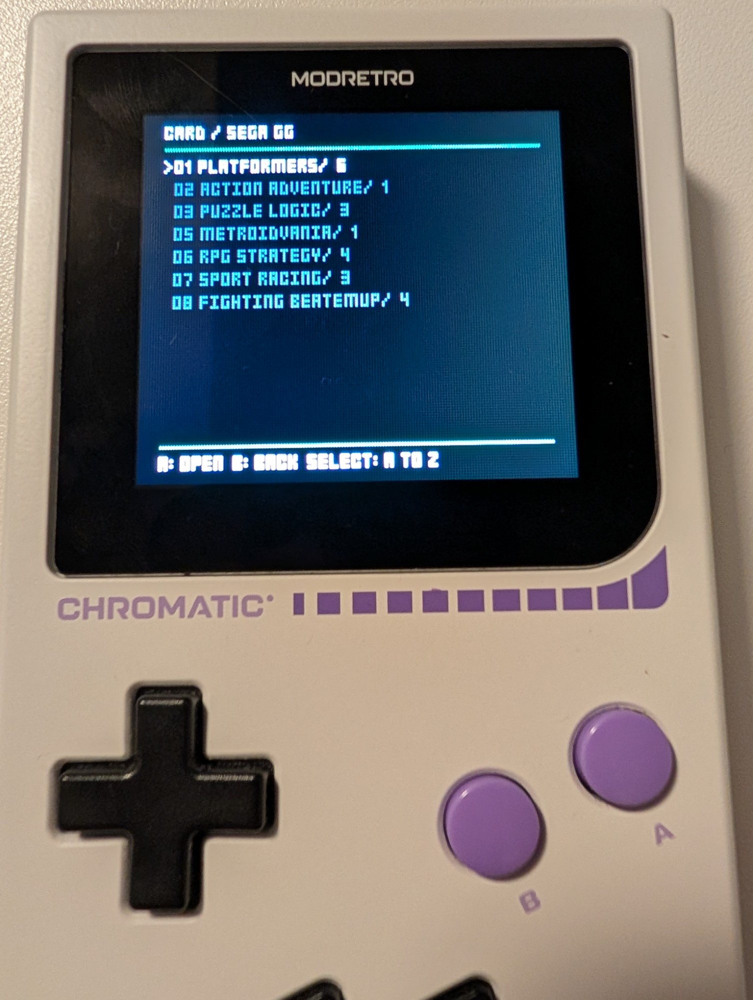
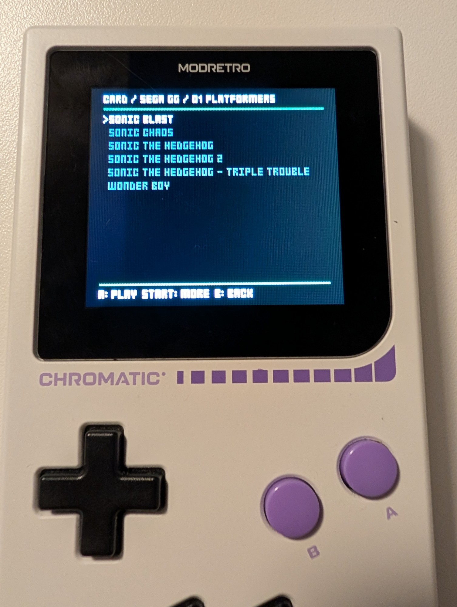
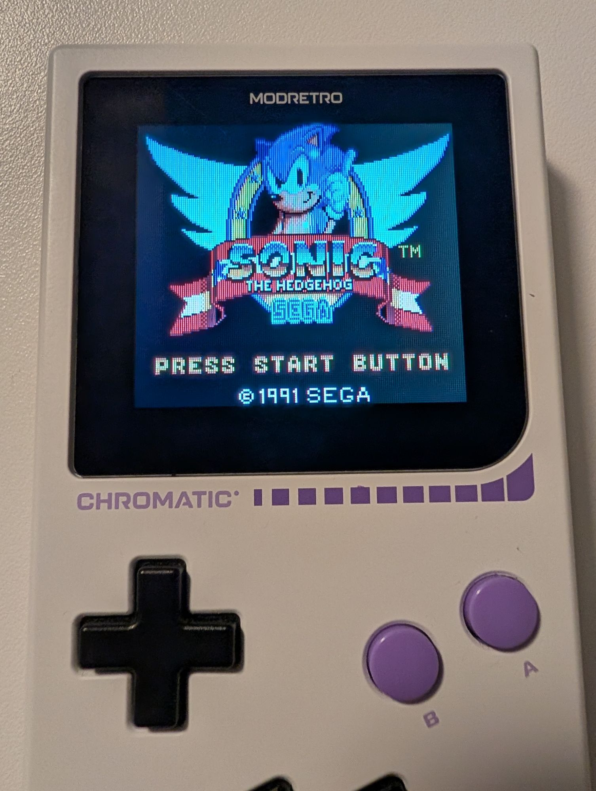
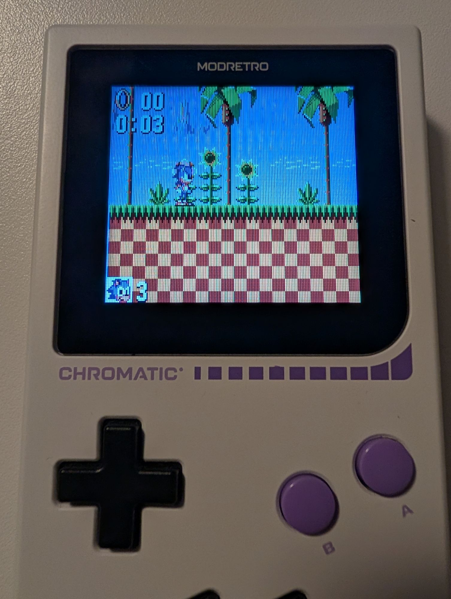
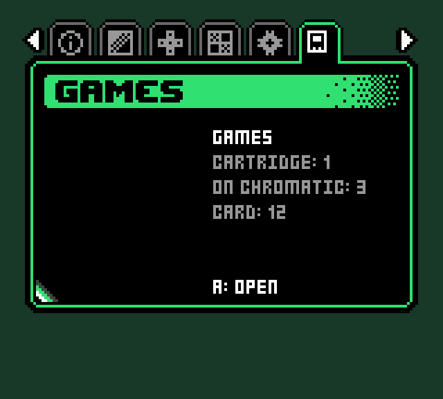
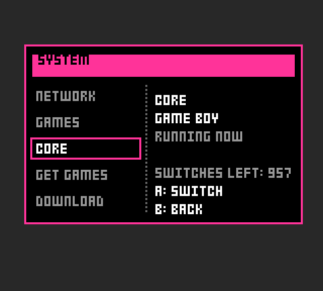
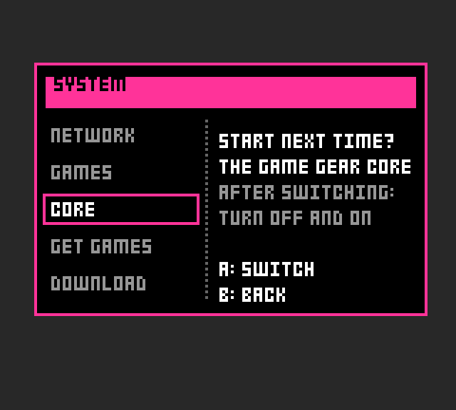

# Game Gear on the ModRetro Chromatic

I wanted to play Sega Game Gear games on my Chromatic. The reason is the screen: the Game Gear has the same
resolution as the Game Boy, 160 x 144, which is exactly the Chromatic's screen. So nothing is scaled, every
pixel of the game is one pixel of the screen.

This repository is what came out of it: a Game Gear core for the Chromatic's FPGA, and a firmware that keeps
it on the console next to the Game Boy core, so you pick which one the console starts with.

It is built on Shiny Relay 1.1.5 (by Shiny Gen, https://shinyrelay.com), which is a modified version of
ModRetro's open-source FPGA design and ESP32 firmware. The Game Gear core is the MiSTer SMS core, running in
Game Gear mode. I have nothing to do with ModRetro, Shiny Gen, Sega or Nintendo. `NOTICE.md` says where every
part comes from and under which licence, `CHANGES.md` says what I changed.

No games are included. You need your own ROM files.

## How it looks

My console: the Game Gear folders on the card, the games in one of them, and Sonic the Hedgehog running.

<p>




</p>

## What you see on the console

GAMES has a tab of its own in the menu, and SELECT opens the game list from anywhere in the menu. The list
takes the whole screen and shows the folders as they are on the card. SELECT again changes the view: A to Z,
last played, folders.

The list shows only the games of the core that is running. With the Game Boy core you see your Game Boy
games, with the Game Gear core you see the Game Gear ones. Right after power-on it says READING THE CORE for
a few seconds, until the firmware knows which core the FPGA started.

SYSTEM has a new entry, CORE. It shows the core that is running, how many switches are left, and A switches
to the other core. The switch happens the next time you turn the console off and on.

<p>

 CORE">

</p>

These three are not photos. They are drawn on a PC by the same code that draws the pages on the console
(`firmware/shiny-relay-mcu/components/osd/system/host`).

Game Boy cartridges work only with the Game Boy core. If the console is on the Game Gear core and you want
to play a cartridge, switch to the Game Boy core first.

Game Gear saves work like Game Boy saves: the firmware keeps them on the card, in `/SAVES`.

## How it works

The Chromatic is an FPGA with an ESP32 next to it. The FPGA is the console itself, the ESP32 runs the menu,
the card and Wi-Fi. When you turn the console on, the FPGA loads its design from a 4 MiB flash chip. At the
start of that chip there are small 64-byte headers that tell it where the design is. Shiny Relay already uses
them to make its updates safe.

I split the space after the recovery design in two slots, one for the Game Boy design and one for the Game
Gear design. Both are on the console all the time. Which one starts depends only on where the header points.

That is also why a switch needs off and on. The FPGA reads the header once, at power-on, before any button
can be read and before the ESP32 is awake. Nothing on the console can make it load again. So the menu writes
a new header and asks you to turn the console off and on.

### Why the switches are counted

A header cannot be changed once it is written, and it cannot be erased alone. The only thing you can do is
write a newer one in the next free place, and the FPGA takes the newest. There are 31 places, so with one
header per switch the console would stop switching after 31 times.

To get around that, the fixed header does not point to a design. It points to a small sector that has 31
header places of its own, and those point to the design. A switch writes in that sector. When the sector is
full, the firmware prepares a second one and spends one fixed place to move to it. That gives about
31 x 31 = 960 switches.

SYSTEM > CORE shows how many are left. When they are gone, the console stays on the core it was running and
works as before, it just cannot switch any more. The only way to get the switches back is to install again
over USB with the installer: it writes fresh headers and the count starts from about 960 again. Your games
and saves are on the card, so the reinstall does not touch them.

### How a Game Gear game gets in

Shiny Relay plays card games by loading them in the RAM that sits where the cartridge would be. I use the
same path. `tools/gg2gb.py` puts a Game Boy header in front of the Game Gear ROM, with a mark in it, so the
firmware handles the file like any card game and knows it needs the Game Gear core. The Game Gear design
reads the ROM from that RAM, and the game's 32 KiB of save RAM is in the same place, which is how the
firmware can keep the save on the card.

## Why there is an installer

The first install cannot be done from the menu. The flash chip has to be laid out again: both designs in
their slots and fresh headers. An update from the menu only knows how to replace one design. So the first
write goes through the console's Gowin cable, with `openFPGALoader`.

`tools/installer` does it in order: it makes a backup of the console, checks the files, writes the firmware
and the flash image, and reads the image back. It can also put the backup back, and it can put a Game Gear
game on the card over USB.

You need:

- a Chromatic that already runs Shiny Relay 1.1.5. The installer refuses anything else.
- `openFPGALoader` with GWU2X support, Python 3.9 or newer, `esptool` 4.x and `pyserial`.
- the six files of a release of this repository (`mcu_fw.bin`, `ota_data_initial.bin`, `partition-table.bin`,
  `fpga-gb.bin`, `fpga-gg.bin`, `SHA256SUMS`), or the same files built from this tree.

Read `tools/installer/README.md` first. In short:

```sh
python3 tools/installer/chromatic_install.py check
python3 tools/installer/chromatic_install.py backup --dir backups
python3 tools/installer/chromatic_install.py install --backup backups/TIMESTAMP --files release --live gb
python3 tools/installer/chromatic_install.py addgame YOUR_GAME.gg --folder "Favorites"
```

Keep the backup. It is the way back, and it may have your Wi-Fi password in it, so do not give it to anyone.
After anything that uses the Gowin cable the screen stays dark until you turn the console off and on.

## What it does not do

- I tested it on my console, from a Mac. I did not try the installer on Windows or Linux.
- An update from the menu replaces only the design of the core that is running.
- There is no Gear-to-Gear link.

## Layout of this repository

| Path | What |
|---|---|
| `firmware/shiny-relay-mcu/` | the ESP32 firmware: Shiny Relay 1.1.5's `mcu/` with the changes of `CHANGES.md` (version 1.1.5-fr3o) |
| `fpga/shiny-relay-1.1.5/` | Shiny Relay 1.1.5's FPGA project, unchanged: the base both designs are built from |
| `fpga/game-boy-patches/` | two patches on that base for the Game Boy design |
| `fpga/game-gear/` | the Game Gear design: the files that are new or changed against the base (`overlay/`), its simulation, notes |
| `tools/` | `gg2gb.py`, `chromatic_flash_image.py`, the installer, console helpers |

Building the FPGA designs needs the Gowin tools (the shipping USB device uses Gowin's encrypted IP, as in
ModRetro's release); building the firmware needs ESP-IDF 5.3. See `firmware/README.md` and
`fpga/game-gear/README.md`.

## Licence

GPL-3.0 for this repository as a whole (`LICENSE`), with the third-party parts under their own licences as listed
in `NOTICE.md`. There is NO WARRANTY. Flashing a console can leave it unable to start until it is written again
through the cable; make the backup first.
